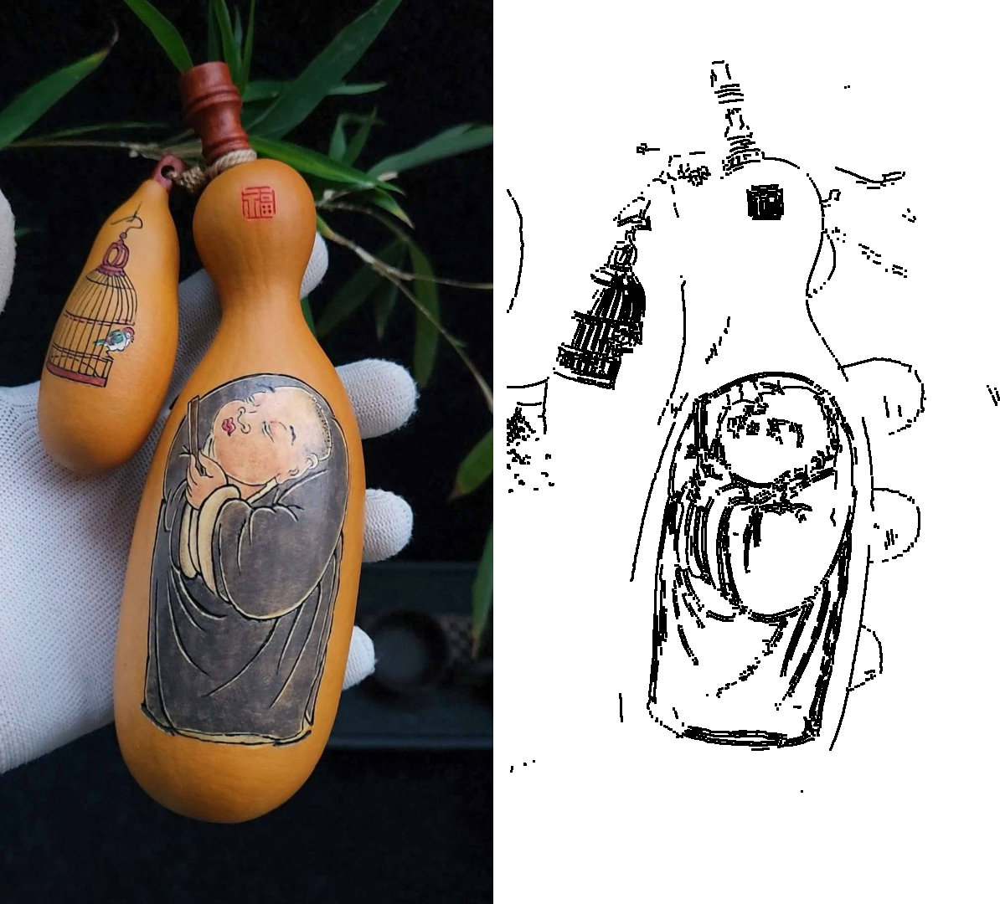
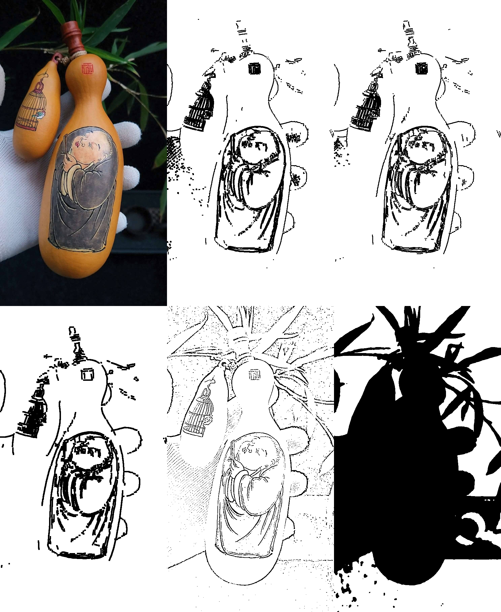

# 线稿生成 LineArt Generator

<p align="center"><b>一键把彩色 / 黑白照片转成纹身级线描底稿</b><br>纯白底色 · 线条清晰 · 同尺寸对比 · 完全离线</p>

<p align="center">
  
</p>
<p align="center"><sub>左：导入原图　|　右：标准线稿模式输出（细节保留 55 / 浓度 50 / 净化 50 / 暗背景抑制开启）</sub></p>

## 简介

**线稿生成**是一款专为**纹身转印底稿**设计的 Android 工具。从相册导入任意彩色或黑白图片，App 自动输出底色干净、线条清晰的黑白线描图，可直接用于纹身转印打印。

- 🖼️ **傻瓜式三步操作**：选图片 → 裁剪选区 → 生成线稿，无需任何专业知识
- ✂️ **自由裁剪**：在图上拖动 8 手柄选区，框选需要的部分再生成线稿；三分线辅助构图
- 🆚 **同尺寸实时对比**：原图与线稿在对比框中**完全等大**，拖动分割线逐区查看，长按看原图，双击锁定
- 🧼 **干净输出**：纯白底色 + 噪点清理 + 暗背景抑制，专为转印优化
- 🎚️ **精细可调**：5 种线稿模式 × 4 个调节滑杆 × 2 个开关
- 📄 **全分辨率保存**：保存 / 分享时按原图分辨率（最高 2600px 长边）重新生成，满足打印需求
- 🔒 **完全离线**：所有算法本地运行，零联网、零权限、无广告，图片不出设备

## 五种线稿模式

| 模式 | 说明 | 适用 |
|---|---|---|
| **精细白描** | 细线、高细节、闭合轮廓，最接近工笔白描 | 五官、纹样等精细图案 |
| **标准线稿** | 均衡模式，线条干净、主体突出 | 大多数照片，推荐首选 |
| **粗犷轮廓** | 粗线轮廓，忽略细节 | 远观剪影、大轮廓设计 |
| **素描排线** | XDoG 算法，保留明暗排线质感 | 带明暗层次的设计稿 |
| **黑白块面** | 自适应阈值二值，亮部变黑块 | 明暗分区 / 剪影设计 |

## 调节参数

| 参数 | 范围 | 作用 |
|---|---|---|
| **细节保留** | 1–100 | 越高保留越多细节（背景纹理也会变多），越低越平滑 |
| **线条粗细** | 0–5 | 控制线条加粗程度 |
| **线条浓度** | 1–100 | 越高线条越多越浓，越低只保留强边缘 |
| **背景净化** | 0–100 | 删除孤立小杂点、碎屑噪声 |
| **暗背景抑制** | 开 / 关 | 暗背景照片（主体亮、背景暗）推荐开启，可去除背景杂线 |
| **反色输出** | 开 / 关 | 输出白线黑底，适配不同转印方式 |

所有参数**实时预览**，滑动即见效果；切换模式自动载入该模式的推荐参数。

## 各模式效果总览

<p align="center">
  
</p>
<p align="center"><sub>左上原图；依次为：精细白描 / 标准线稿 / 粗犷轮廓 / 素描排线 / 黑白块面</sub></p>

## 下载安装

从 [Releases](../../releases) 下载最新 APK（`LineArt-Generator-v1.0.0.apk`），传到手机后点击安装（需允许"安装未知来源应用"）。

- 系统要求：Android 7.0（API 24）及以上
- 体积仅 ~70KB，无任何第三方依赖

## 使用方法

1. 打开 App，点击**选择图片**，从相册导入照片
2. 在**裁剪界面**拖动边角/边中手柄框选需要的部分（框内拖动平移，三分线辅助构图）；也可点击**使用整张图**
3. 进入对比编辑界面，左右拖动**红色分割线**对比原图与线稿；**长按**屏幕查看完整原图；**双击**锁定 / 解锁
4. 按需切换**线稿模式**、调整滑杆参数，实时预览
5. 满意后点击**保存线稿**（存至相册 Pictures/LineArt），或**分享 / 打印**发送到转印打印机对应的 App

> 💡 小技巧：拍摄时使用**纯色浅背景**效果最佳；背景较暗的照片请打开**暗背景抑制**。

## 从源码构建

本项目不依赖 Gradle，使用标准 Android 构建工具链手动构建：

```bash
# 依赖：JDK 17+、Android Build-Tools 34、Android Platform 34 (android.jar)
export SDK_BT=/path/to/android-sdk/build-tools/34.0.0
export PLATFORM=/path/to/android-sdk/platforms/android-34/android.jar

# 生成签名密钥（首次）
keytool -genkeypair -keystore release.keystore -alias lineart \
    -keyalg RSA -keysize 2048 -validity 10000

bash build.sh
```

## 技术原理

核心算法 `LineArtEngine` 为纯 Java 实现（约 400 行），不依赖 OpenCV 等任何第三方库：

- **边缘类模式（白描 / 标准 / 粗线）**：灰度化 → 可分离高斯模糊（σ 随细节参数自适应）→ Sobel 梯度 → 非极大值抑制 → 双阈值滞后连接（阈值随浓度参数自适应）→ 暗背景抑制 → 形态学闭运算连接断线 → 按粗细膨胀
- **素描排线模式**：XDoG（高斯差分 + 软阈值），保留排线灰调质感
- **黑白块面模式**：积分图加速的局部自适应阈值（正片式：亮部→黑块，暗背景→白）
- **背景净化**：基于「面积 + 包围盒」双判定的连通域噪声清理——删除孤立点状噪声，同时保护细长线段不被误删
- **EXIF 方向**：内置极简 JPEG EXIF 解析器，自动纠正竖拍照片旋转

## 项目结构

```
├── app/                    # 清单与资源
│   ├── AndroidManifest.xml
│   └── res/                # 布局 / 图标 / 样式
├── src/com/lineart/gen/
│   ├── MainActivity.java   # 导入图片
│   ├── CropActivity.java   # 自由裁剪选区
│   ├── CropView.java       # 可拖动选区控件（8 手柄 + 三分线 + 遮罩）
│   ├── CompareActivity.java# 对比编辑（滑杆 / 保存 / 分享）
│   ├── CompareView.java    # 同尺寸滑动对比控件
│   ├── BitmapUtils.java    # 解码 / EXIF / 像素转换
│   ├── MiniFileProvider.java# 无 androidx 依赖的文件分享 Provider
│   └── core/LineArtEngine.java  # 核心算法（纯 Java，可独立测试）
├── build.sh                # 手动构建脚本（aapt2 + javac + d8 + apksigner）
└── docs/                   # 效果演示图
```

## 许可证

[MIT License](LICENSE)
